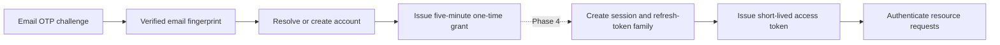

# Passwordless Identity Engineering Note

**Scope:** Phase 3 — accounts, verified login identities, one-time sign-in grants, and security audit events.

Phase 3 proves who controls an email address and resolves that identity to an account. It does **not** yet create or maintain a browser login session. Sessions, OAuth/OIDC, access tokens, rotating refresh tokens, logout, and revocation belong to Phase 4; production Next.js BFF integration belongs to the later cutover phase.

## Current authentication boundary

The verification grant is an authentication handoff, not a product permission, bearer access token, or durable session. It states that a particular identity completed the `sign_in` flow for a configured audience. The plaintext grant is returned once; only its SHA-256 digest is stored. Consumption validates its purpose, audience, expiry, one-time state, and account status.

The public Phase 3 API starts and verifies passwordless challenges. Grant consumption currently exists only as an internal module operation for the future session/token issuer.

## Persistence model

| Record | Responsibility |
|---|---|
| `accounts` | Stable account identity and lifecycle state. |
| `login_identities` | Unique mapping from a protected email fingerprint to one account. Raw email addresses are not retained. |
| `verification_grants` | Short-lived, audience-bound, single-use proof that sign-in verification succeeded. |
| `security_events` | Security audit history; it does not authorize requests or keep users logged in. |
| Operation guards | PostgreSQL rows used only as transactional lock targets. |

The original challenge constraint allowed only `restricted_resource_access`. Phase 3 drops and recreates it with `sign_in` added because PostgreSQL check expressions cannot be extended in place. The constraint remains intentionally strict so invalid purposes cannot enter through another writer or operational script.

### Account fields and states

- `token_not_before` is an account-wide authentication invalidation timestamp. A future token/session layer should reject tokens issued before it. Phase 3 advances it on account state changes but does not yet enforce it against JWTs or invalidate an unconsumed grant by its creation time.
- `version` is Hibernate optimistic-lock metadata. It detects stale writes by updating only when the stored version still matches. Account mutation paths also take pessimistic row locks so security-sensitive transitions are serialized and observe the latest state.
- `version` uses Java `long` and PostgreSQL `BIGINT`. Exhausting its signed 64-bit maximum is operationally unrealistic; even one million successful updates per second to one account would require roughly 292,000 years. Overflow would fail and roll back rather than silently succeed.
- `RECOVERY_LOCKED` represents a future dedicated recovery-risk state. No current operation can enter that state, so it should remain only if the recovery workflow is planned; otherwise it should be introduced with that workflow instead of being speculative state.

## Concurrency strategy

Pessimistic and optimistic locking overlap but act at different times:

- `SELECT ... FOR UPDATE`/`PESSIMISTIC_WRITE` prevents a conflict by making competing writers wait before changing state.
- `@Version` detects a stale write at flush time and rolls its transaction back. It is useful protection for future update paths that do not explicitly lock.
- Neither can lock a row that does not exist, which is why first-time identity creation uses pre-created guard rows plus a database unique constraint.

There are two guard designs:

- Email-verification challenge creation uses one singleton guard because it calculates a strict global start limit and coordinates cleanup. A global invariant requires a global serialization point. OTP verification and email delivery are not serialized by this guard.
- Identity creation uses 64 striped guards because its invariant is per identity: one fingerprint maps to one account. The first fingerprint byte selects a stripe, so identical identities always serialize while most unrelated identities proceed concurrently. The unique `(kind, identifier_fingerprint)` constraint remains the final safety net.

These PostgreSQL row locks coordinate every IAM instance sharing the database, are released automatically on commit/rollback/failure, and do not require Redis.

## Defensive digest handling

Grant digests are `byte[]`, which remains mutable even inside a Java record. `digest.clone()` on construction prevents mutation through the caller's original array, and cloning again in the accessor prevents callers from modifying the record's internal array. The same defensive-copy rule applies when entities accept fingerprint or digest arrays.

## Sessions and token lifecycle

Phase 4 should consume the one-time grant and create the durable authentication state:

| Artifact | Intended behavior |
|---|---|
| Session | Server-side account/client login state with expiry and revocation status. |
| Refresh token | Longer-lived opaque credential, stored only as a digest, rotated on every use, with reuse detection that revokes the family. |
| Access token | Approximately five-minute asymmetric JWT used by resource services and validated locally from IAM JWKs. |

The recommended browser boundary is a same-origin Next.js BFF. Browser JavaScript should not store access or refresh tokens in `localStorage`. The BFF completes Authorization Code + PKCE, retains sensitive credentials server-side, and gives the browser a `Secure`, `HttpOnly`, `SameSite` session cookie. It attaches short-lived access tokens when calling protected Go APIs.

Revocation should stop refresh immediately by revoking the session/token family and clearing the BFF cookie. A locally validated access token normally remains usable until its short expiry unless the platform adds introspection or a distributed revocation signal. `token_not_before` requires such current account state to be visible to resource services before it can provide immediate revocation.

Security events record grant, account, session, token, and administrative changes for audit and incident response. They are evidence of an operation, not the source of authentication state.

## OAuth distinction

Phase 3 is first-party passwordless authentication, not Google-style OAuth delegation. It has no client registration, redirects, consent, scopes, authorization endpoint, PKCE, refresh tokens, signed access tokens, discovery, or JWK publication. Phase 4 introduces Spring Authorization Server and integrates passwordless verification as an authentication mechanism within the standards-based flow rather than creating a separate token system.
